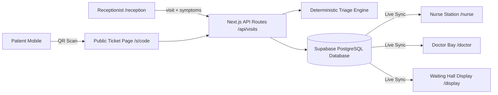

# TriageLane

**Sickest first, not first come.**
An explainable, deterministic patient-priority queue for hospital OPDs, ensuring urgent clinical needs take precedence over arrival order.

- **Live URL:** [https://aayu-project-five.vercel.app/](https://aayu-project-five.vercel.app/)
- **Repository:** [https://github.com/Krishna100bit/aayu-project](https://github.com/Krishna100bit/aayu-project)

---

## 1. What it does

1. **Reception Intake (`/reception`):** Fast patient intake with 102 bilingual symptom tiles, red-flag follow-up modals, automatic department matching, instant deterministic triage preview, and thermal token slip printing with QR code.
2. **Deterministic Triage Engine:** Pure mathematical rule engine that computes priority into three clear clinical lanes (**Immediate / Soon / Routine**) with explainable reasons, tasks, and safety invariants.
3. **Nurse Station (`/nurse`):** Real-time priority lanes with vitals recording (BP, SpO2, RR, HR, temp, consciousness), automated vital sign escalation, auditable clinical overrides with reason codes, and casualty transfer.
4. **Doctor Bay (`/doctor`):** Room bay consultation queue, active consultation timer, clinical rule audit inspector, call next, and discharge.
5. **Public Display (`/display/[dept]`):** High-visibility waiting hall screen showing current token numbers and "now serving" announcements.
6. **Mobile Patient Tracking (`/s/[code]`):** Privacy-safe ticket tracking screen accessible via QR code on the token slip.
7. **Clinical Admin (`/admin`):** Rule DSL inspector, department directory, clinical escalation threshold settings, and audit log.

---

## 2. Tech Stack

| Layer | Technology | Details & Purpose |
|---|---|---|
| **Framework** | **Next.js 15 (App Router)** | Full-stack React framework with server components and edge-ready API routes |
| **Language** | **TypeScript 5** | Strict end-to-end type safety across the entire application and database models |
| **Runtime & React** | **React 19** | Modern concurrent rendering and reactive UI updates |
| **Styling & Design System** | **Tailwind CSS v4** | Modern CSS-first engine; custom warm paper palette (`#F6F3EC`), hairline borders, and accessible high-contrast mode |
| **Database & Auth** | **Supabase (PostgreSQL 15+)** | Managed PostgreSQL with 13 relational tables & views, PL/pgSQL token sequences, and RLS |
| **Supabase SDKs** | **`@supabase/supabase-js` & `@supabase/ssr`** | Isomorphic database clients for browser and server environments |
| **State & Data Sync** | **`@tanstack/react-query` & Reactive Queue Store** | Optimistic UI mutations with live REST API sync to Supabase |
| **Validation** | **Zod v4** | Runtime schema validation for API payloads, vitals, and environment configurations |
| **Icons** | **Lucide React** | Clean, accessible clinical iconography |
| **Localization (i18n)** | **next-intl** | Internationalization supporting English and Hindi medical terminology |
| **Testing** | **Vitest & Playwright** | Fast unit tests for pure triage math + end-to-end browser testing |
| **Deployment** | **Vercel** | Automated continuous deployment with GitHub Actions CI pipeline |

---

## 3. Architecture at a glance



---

## 4. Clinical Priority Lanes

| Lane | Indicator | Target Wait | Clinical Urgency |
|---|---|---|---|
| **Immediate** | 🛑 Brick Red Octagon | ≤ 5 minutes | Severe red flags, respiratory distress, shock, acute chest pain |
| **Soon** | ⚠️ Amber Triangle | ≤ 30 minutes | Significant symptoms, vulnerable age modifiers, persistent fever |
| **Routine** | 🟢 Neem Green Circle | Regular flow | Stable baseline presentations, routine consults |

---

## 5. Repository Layout

```
triagelane/
├── src/
│   ├── app/                     # Next.js App Router pages & API routes
│   │   ├── (auth)/              # Role-specific dashboard layouts
│   │   ├── reception/           # Fast patient intake & token generation
│   │   ├── nurse/               # 3 live priority lanes & vitals recording
│   │   ├── doctor/              # Consultation bay & queue management
│   │   ├── display/[dept]/      # Public waiting hall display board
│   │   ├── s/[code]/            # Privacy-safe mobile ticket tracker
│   │   ├── admin/               # Rules inspector & audit viewer
│   │   └── api/visits/          # REST endpoints syncing with Supabase
│   ├── components/              # Shared UI design system & badges
│   ├── engine/                  # Pure deterministic triage engine (Rule DSL & vitals)
│   ├── lib/                     # Supabase clients (client, server, admin) & queue store
│   └── i18n/                    # Localization config & dictionary setup
├── db/
│   └── schema.sql               # PostgreSQL tables, views (v_queue), sequences, and RLS
├── data/                        # Medical symptoms catalog, rule definitions, departments
├── scripts/                     # Supabase seed scripts and database verification tools
└── tests/                       # Unit tests & clinical scenario test suites
```

---

## 6. Local Development Quick Start

### 1. Clone & Install Dependencies
```bash
git clone https://github.com/Krishna100bit/aayu-project.git
cd aayu-project
pnpm install
```

### 2. Configure Environment Variables
Create a `.env.local` file with your Supabase credentials:
```bash
NEXT_PUBLIC_SUPABASE_URL=https://your-project.supabase.co
NEXT_PUBLIC_SUPABASE_ANON_KEY=your-anon-key
SUPABASE_SERVICE_ROLE_KEY=your-service-role-key
NEXT_PUBLIC_APP_URL=http://localhost:3000
STATUS_PAGE_BASE_URL=http://localhost:3000/s
HOSPITAL_NAME="District Hospital"
LLM_PROVIDER=none
DEMO_MODE=false
```

### 3. Initialize Database
Execute `db/schema.sql` in your Supabase SQL Editor, then seed initial departments and catalog:
```bash
pnpm tsx scripts/seed.ts
```

### 4. Run Development Server
```bash
pnpm dev
```
Open [http://localhost:3000](http://localhost:3000) to view the application.

### 5. Run Quality Checks
```bash
pnpm lint          # Run ESLint validation
pnpm typecheck     # Validate TypeScript types
pnpm test          # Run Vitest unit tests
```
