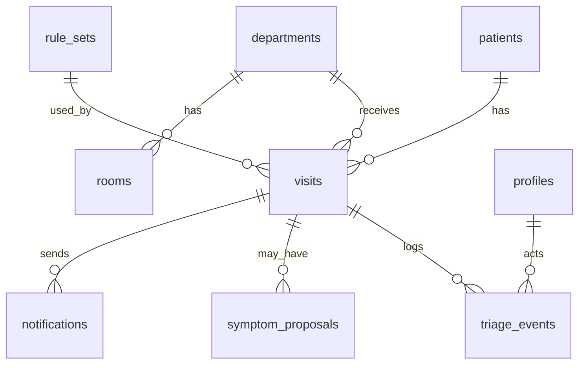

# Architecture and Tech Stack

## 1. Design principles
1. **Logic in our code, delivery in n8n.** Triage, queue and message *content* live in the app (testable, offline-capable). n8n only delivers, schedules and escalates.
2. **One deployable app.** Next.js serves UI and API routes; Supabase provides DB, auth and realtime.
3. **Deterministic core, optional AI at the edges.** The LLM is a parser, never a decider.
4. **Simple beats clever.** Fewest moving parts that a student team can run on a laptop.

## 2. Stack decisions

| Concern | Choice | Alternatives | Notes |
|---|---|---|---|
| Framework | Next.js 15 (App Router), TypeScript | Vite + React + Express | Next gives routes, API and deployment in one |
| UI kit | Tailwind CSS, shadcn/ui, lucide-react | Mantine, Chakra | shadcn components are copy-in, fully editable |
| Data/Auth/Realtime | Supabase (Postgres, Auth, Realtime, RLS) | Firebase, Appwrite, PocketBase | Postgres and SQL views suit queue maths; RLS for roles |
| Server state | TanStack Query + Supabase Realtime | SWR | Realtime invalidates queries |
| Validation | Zod | Valibot | Shared schemas for API, engine and LLM output |
| Rule engine | Own pure function reading `rules.json` | `json-rules-engine` | Own code is simpler to explain and test; library is a fine alternative |
| Fuzzy search | Fuse.js | MiniSearch | Symptom and patient search, Hindi and Roman Hindi |
| Reorder | dnd-kit (+ arrow buttons) | react-beautiful-dnd (deprecated) | Keyboard accessible |
| i18n | next-intl | i18next | Hindi default |
| Offline | Serwist (service worker), Dexie (IndexedDB) | next-pwa, localForage | Outbox pattern |
| Charts | Recharts | Chart.js | Analytics |
| QR | `qrcode` | `qrcode.react` | Token slip |
| Automation | n8n self-hosted (Docker) | Make, Zapier, Node cron | Open source, webhook + cron + nodes for Telegram/WhatsApp/Twilio |
| LLM | Claude Haiku (API) default; Ollama local fallback | Gemini Flash, GPT mini | Free-text parsing only |
| Testing | Vitest (engine), Playwright (flows) | Jest, Cypress | Scenario tests are the safety net |
| Hosting | Vercel + Supabase + n8n on VPS/laptop (ngrok for demo) | Railway, Render | Free tiers |

## 3. Component diagram

```mermaid
flowchart TB
  subgraph Browser PWA
    REC[Reception UI]
    NUR[Nurse UI]
    DOC[Doctor UI]
    ADM[Admin UI]
    ENGC[Engine (client copy)]
    OUT[(IndexedDB outbox)]
  end
  subgraph Server
    API[Next.js API routes]
    ENGS[Engine (server, authoritative)]
    LLMP[LLM parser service]
    REN[Notification renderer]
  end
  DB[(Supabase Postgres)]
  RT[Realtime channels]
  N8N[n8n]
  CH[Telegram / WhatsApp / SMS]
  PUB[Public status page + display board]

  REC --> ENGC
  REC -. offline .-> OUT
  REC --> API
  NUR --> API
  API --> ENGS --> DB
  API --> LLMP
  DB --> RT --> NUR
  RT --> DOC
  RT --> PUB
  DB -- DB webhook --> N8N
  N8N --> REN
  N8N --> CH
  N8N -- status callback --> API
  PUB --> API
```

**Why the engine runs twice:** the client copy gives instant feedback and offline operation; the server copy is authoritative (it recomputes on save, so a tampered client cannot lower priority). Both import the same `src/engine` module and `rules.json` version.

## 4. Data model (see `db/schema.sql`)



| Table | Purpose |
|---|---|
| `patients` | Persistent identity: demographics, phone (shared flag), consent, nurse-verified conditions, allergies |
| `visits` | One row per OPD visit: tags, free text, vitals, level, reason, fired rules, queue fields, status |
| `triage_events` | Append-only audit log (trigger blocks update/delete) |
| `symptom_proposals` | LLM suggestions for unusual text and the nurse's verification outcome |
| `notifications` | Every outgoing message with dedupe key and status |
| `departments`, `rooms`, `profiles` | Reference and users |
| `symptom_tags`, `rule_sets`, `app_settings` | Catalogue, versioned rules, settings |
| `v_queue` | View computing position per department |

## 5. Queue algorithm

**Ordering key** for visits with status in (`registered`, `with_nurse`, `waiting`, `called`) per department:

```
ORDER BY level_rank ASC (IMMEDIATE=1, SOON=2, ROUTINE=3), sort_key ASC
```

- `sort_key` defaults to the arrival epoch. A nurse reorder sets it to the **midpoint** between the two neighbours (fractional indexing), so one drag updates one row. If neighbours get too close (< 1e-6) the lane is renumbered.
- A **level change** keeps `sort_key` (arrival fairness retained). Moving to a higher lane places the patient at the position their `sort_key` implies, which is usually near the top.
- **Reorder within lane** is allowed to any nurse; reason code is optional but suggested. **Cross-lane** is an override and requires a reason code. **Lowering** a level is human-only.
- **Immediate** patients are listed in the nurse's Immediate lane of every department and in the Casualty queue when sent there.
- **Fairness guard:** if `waited_minutes` exceeds the limit (Soon 30, Routine 120 by default) the card shows an *Overdue* badge, the dashboard counter turns amber, and n8n alerts the nurse. Overdue Routine cards sort first **within the Routine lane** only.
- **Status flow:** `registered → with_nurse → waiting → called → in_consult → done` with side exits `skipped`, `sent_emergency`, `left`.

### Position and ETA
```
ahead(v)      = count of visits in same dept with (level_rank, sort_key) < v's, status in (registered, with_nurse, waiting, called)
doctors(d)    = active rooms with a logged-in doctor in dept d (min 1)
avg(d)        = rolling mean of last 20 consult durations in dept d (fallback departments.avg_consult_minutes)
eta_minutes   = ceil( ahead * avg(d) / doctors(d) )
eta_range     = [ round(0.7*eta), round(1.4*eta + 5) ]   // shown as a range, never as a promise
```
ETA excludes future arrivals who may jump ahead; messages say *"may change if emergencies arrive"*.

## 6. Notification pipeline

1. App writes a `triage_events` row and (for notifiable events) enqueues a **notification job** by calling the n8n webhook with `{event, visit_id, secret}`.
2. n8n calls **`POST /api/notify/render`** with `{visit_id, template}`; the app returns channel, phone, language and the final message text (so wording and privacy rules live in the app).
3. n8n sends via Telegram, WhatsApp or SMS, then calls **`POST /api/notify/callback`** with delivery status.
4. A **cron workflow** (every minute) calls `GET /api/queue/watch` to find patients whose position crossed a threshold, who have been called but not arrived, or who are overdue, and triggers the matching templates.
5. **Dedupe:** `dedupe_key = visit_id|template|position_bucket` prevents repeats; **rate limit** one non-critical message per patient per 10 minutes.
See `docs/N8N_WORKFLOWS.md`.

## 7. API surface (Next.js route handlers)

| Method and path | Role | Purpose |
|---|---|---|
| `GET /api/patients/search?q=` | reception, nurse | Search by phone, name, UHID (Fuse + SQL) |
| `POST /api/visits` | reception | Create/update patient, create visit, run engine (server), write events, enqueue N1 |
| `PATCH /api/visits/:id/vitals` | nurse | Save vitals/details, re-run engine, event, enqueue N2 |
| `POST /api/visits/:id/override` | nurse, doctor | `{to_level, reason_code, note}` |
| `POST /api/visits/:id/reorder` | nurse | `{before_id, after_id}` fractional index |
| `POST /api/visits/:id/department` | reception, nurse | Change department, new token in dept, event |
| `POST /api/visits/:id/call` | nurse, doctor | Status `called`, room, enqueue N5 |
| `POST /api/visits/:id/status` | nurse, doctor | skipped, sent_emergency, in_consult, done |
| `POST /api/llm/parse` | reception | Free text to tag suggestions (see LLM doc) |
| `POST /api/proposals/:id/verify` | nurse | Accept/edit/reject; set level; flag for catalogue |
| `GET /api/queue?dept=` | staff | Queue with positions and ETAs |
| `GET /api/queue/watch` | n8n | Threshold events for cron |
| `POST /api/notify/render` | n8n | Final message and channel for a visit and template |
| `POST /api/notify/callback` | n8n | Delivery status |
| `GET /s/[code]` | public | Status page (server-rendered, minimal data) |
| `GET /display/[dept]` | public (screen) | Waiting-hall board: token labels only |
| `GET/POST /api/admin/rules` | admin | List, draft, approve rule versions |
| `GET /api/analytics` | admin | Aggregates |

All staff routes check role on the server (RLS plus explicit checks). n8n routes require the `X-TL-Secret` header.

## 8. Realtime
Supabase Realtime channels `queue:{department_id}` (visit inserts/updates), `events` (admin audit viewer), and `display:{department_id}` (public display via a server-side relay that strips PHI). Clients re-fetch `v_queue` on change; optimistic updates for reorder.

## 9. Offline-first registration
- Service worker caches the shell, symptom catalogue, rules.json and fonts.
- Registration while offline: run the client engine, store the visit in the IndexedDB **outbox** with a client UUID and local token (`OFFLINE-xx`), print a slip without QR.
- On reconnect the outbox posts to `/api/visits`; the server recomputes with the authoritative engine, issues the real token and fires N1. UI shows "synced" state.
- Conflict rule: server result wins; if the server level is higher than what staff saw, an alert is raised.

## 10. Security and privacy
- Supabase Auth with email/password for staff; roles in `profiles`; RLS on all patient tables.
- Service role key only in server env; never in the browser.
- n8n webhook secret header and IP allow-list when possible.
- Public status code: 10 hex chars (`gen_random_bytes(5)`), not the token number; page shows token, dept, position, ETA range, generic reason. No names, ages or symptoms.
- Waiting-hall display shows token labels and "now serving" only.
- Notification text contains no symptoms, no diagnosis, no other patients.
- LLM requests contain only the symptom text (no name, phone or ID); log stored internally.
- Retention setting (default 30 days for demo). Data protected under India's DPDP Act 2023 in a real deployment; legal review required.
- Rate limiting on public routes; CORS locked to the app domain.

## 11. Deployment

| Component | Where |
|---|---|
| App | Vercel (hobby) |
| DB/Auth/Realtime | Supabase free project |
| n8n | `docker compose` on a small VPS, or on a laptop exposed with ngrok/cloudflared for the demo |
| LLM | Anthropic API; or Ollama on the demo laptop with `qwen2.5:3b` |
| Domain/QR | Short URL such as `https://tl.vercel.app/s/<code>` |

`n8n/docker-compose.yml` (provided in Phase 6) runs n8n with a persistent volume and the shared secret.

## 12. Folder conventions
- `src/engine` has **no** imports from React, Next or Supabase. It exports `evaluate(input, rules) => TriageResult`.
- `src/lib/queue.ts` contains position/ETA/reorder maths with unit tests.
- `src/llm/parser.ts` has the provider interface, prompt, Zod schema, and guardrails.
- Environment variables only through `src/lib/env.ts` (Zod-validated).
